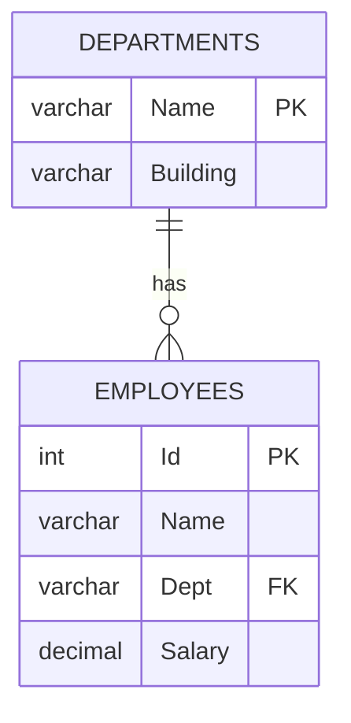

# SQL Joins (sample page)

> This is a sample page that shows how a new technology looks. Replace it with your own SQL notes: drop `.md` files into `content/sql/` and run `node build.js`.

## Sample tables



```sql
CREATE TABLE Departments (Name VARCHAR(30) PRIMARY KEY, Building VARCHAR(30));
CREATE TABLE Employees   (Id INT PRIMARY KEY, Name VARCHAR(50), Dept VARCHAR(30), Salary DECIMAL(10,2));

INSERT INTO Departments VALUES ('IT','Tech Park'), ('HR','HQ'), ('Legal','Annex');
INSERT INTO Employees   VALUES (1,'Rohit','IT',60000), (2,'Priya','HR',45000), (3,'Amit','IT',75000), (4,'Neha','Finance',52000);
```

Note that `Legal` has no employees and `Neha`'s department (`Finance`) isn't in `Departments`.

## Join types

```sql
-- INNER JOIN: only matching rows on both sides
SELECT e.Name, d.Building
FROM Employees e
INNER JOIN Departments d ON d.Name = e.Dept;          -- Rohit, Priya, Amit

-- LEFT JOIN: every employee, building or NULL
SELECT e.Name, d.Building
FROM Employees e
LEFT JOIN Departments d ON d.Name = e.Dept;           -- ... Neha NULL

-- RIGHT JOIN: every department, employee or NULL
SELECT d.Name, e.Name
FROM Employees e
RIGHT JOIN Departments d ON d.Name = e.Dept;          -- ... Legal NULL

-- FULL OUTER JOIN: everything from both sides
SELECT e.Name, d.Name
FROM Employees e
FULL OUTER JOIN Departments d ON d.Name = e.Dept;     -- Neha/NULL and NULL/Legal both appear

-- Departments with no employees (anti-join)
SELECT d.Name
FROM Departments d
LEFT JOIN Employees e ON e.Dept = d.Name
WHERE e.Id IS NULL;                                   -- Legal
```

| Join | Keeps unmatched left rows | Keeps unmatched right rows |
| --- | --- | --- |
| `INNER JOIN` | No | No |
| `LEFT JOIN` | Yes | No |
| `RIGHT JOIN` | No | Yes |
| `FULL OUTER JOIN` | Yes | Yes |
| `CROSS JOIN` | Every combination (no `ON`) | |

## Checklist

- [ ] Explain INNER vs LEFT JOIN with an example
- [ ] Find rows with no match using `LEFT JOIN ... WHERE x IS NULL`
- [ ] Know when to use `FULL OUTER JOIN`
